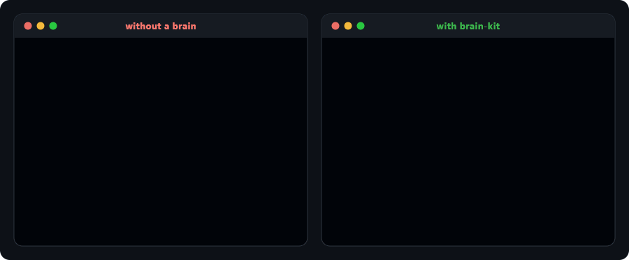
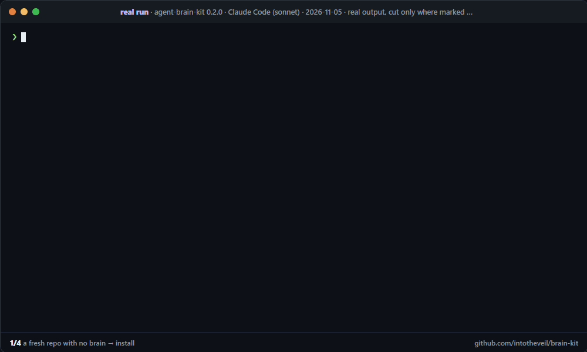

<div align="center">

# brain-kit

### Your coding agent forgets everything. Make it stop.

**One file it reads first and writes last. A crew where no agent grades its own homework.<br>Hooks that make both non-optional.**

[](https://www.npmjs.com/package/agent-brain-kit)
[](LICENSE)
[](package.json)
[](https://claude.com/claude-code)
[](https://github.com/intotheveil/brain-kit/actions/workflows/verify.yml)

```bash
npx agent-brain-kit setup
```

**[Website](https://intotheveil.github.io/brain-kit/)** · **[The receipts](docs/receipts.md)** · **[Hall of Gotchas](docs/hall-of-gotchas.md)** · **[A real brain](examples/BRAIN.example.md)**

<br>



</div>

---

## Not a weekend demo

Everything here was extracted from a private fleet that has run it **every day since July 2026**.
Names removed, numbers not ([how each was counted](docs/receipts.md)):

| | |
|---:|---|
| **53** | repos running the brain: web apps, a desktop app, firmware, data pipelines, research code, games in four engines |
| **3,142** | commits that wrote a brain: about one in three of all commits |
| **~2,600** | gotchas written down, each learned the hard way exactly once |
| **57** | times an independent QA agent **failed work the builder had reported as done** |
| **296** | reviewer REVISE verdicts, sent back with the exact miss |
| **8,098** | tests in the biggest repo, built by the crew |

The crew is the part people underestimate. Without it, every one of those 57 failures would have
been merged as "done".

---

## The problem

If you work with coding agents for any length of time you already know the failure:

- Knowledge scatters across chat sessions and dies with them.
- A chat gets too big, so you write a handover, and the handover is lossy.
- The same investigation gets re-run weeks later, burns tokens, and sometimes returns a
  **different answer** than last time.
- The agent says "done, all tests pass", and the thing does not run.

The usual fix is better prompts or a bigger context window. Neither works, because the problem is
not recall. It is that **nothing durable was ever written down, and nothing independent ever
checked the claim.**

## The fix


```
1. READ    BRAIN.md, in full, before any work
2. WORK    planner → builder → test-writer → qa → reviewer
3. WRITE   BRAIN.md, before the session ends
```

Step 3 is the one everybody skips, and skipping it is what makes step 1 worthless. A brain updated
*usually* is worse than no brain, because you cannot trust it, so you re-investigate anyway.
**Trust requires discipline: read every time, write every time.**

The payoff is that handovers stop existing. The brain *is* the handover, continuously. Start new
chats freely; nothing is lost.

### A real run, not a mock-up

The animation at the top is an illustration. This one is not. It shows a sample repo, the published
package, and **one real Claude Code session** given only the prompt `setup` suggests:



The session was asked to fill §1–§2. It **also** wrote a changelog entry, a "left off" pointer and a
fresh date, because the loop in `.claude/CLAUDE.md` tells every session to. Nobody prompted those.
60 → 85. §5 stays empty until something actually bites, because a gotcha has to be earned. Every
line is real output ([raw captures](scripts/real-run/captures/)); the 74-second session is sped up.

---

## Quickstart

### One command (recommended)

From the root of any repo:

```bash
npx agent-brain-kit setup
```

```
  created  BRAIN.md
  created  .claude/CLAUDE.md            brain loop
  created  .claude/agents/              7 agents: builder, explore, planner, qa, researcher, reviewer, test-writer
  created  .claude/hooks/               7 hooks: _json, brain-check, format, guard, notify, secret-scan, subagent-gate
  created  .claude/settings.json        6 hooks wired

  17 created · 0 kept · 0 merged

Next:
  1. Open Claude Code in this repo and ask it to "fill BRAIN.md §1–§2 from the codebase".
  2. Check the brain's health any time: npx agent-brain-kit doctor
```

It **never overwrites a file you already have**. Run it twice and everything is `kept`. An existing
`settings.json` is merged (our hooks added once, nothing of yours removed, a backup kept).

| flag | does |
|---|---|
| `--dry-run` | print the plan, write nothing |
| `--full` | compose the full project constitution instead of just the brain loop |
| `--no-crew` | skip the seven agents |
| `--no-hooks` | skip the hooks and `settings.json` |

### Just the brain (no tooling)

This is most of the value, and it works with any agent:

```bash
cp templates/BRAIN.template.md  /path/to/yourrepo/BRAIN.md
cat BRAIN_DISCIPLINE.md      >> /path/to/yourrepo/.claude/CLAUDE.md   # or AGENTS.md, .cursorrules, a system prompt
```

---

## Is your brain healthy? `doctor`

```bash
npx agent-brain-kit doctor
```

Grades a repo's brain in under a second and prints a one-line fix for every miss: all sections
present, §1–§2 actually filled, how fresh "Last updated" is, real gotchas (not template
placeholders), a "left off" pointer on the newest changelog entry, an outstanding table that parses,
the read-first loop present in `CLAUDE.md`/`AGENTS.md`, and the size limits that bite in practice.

```
  ✔ 15/15  core sections §1–§7 all present
  ✖  0/15  §5 GOTCHAS has no real entry (template placeholders only)
           → record the first thing that cost you an hour — the most valuable section, and the one that is normally lost
  ✔ 15/15  .claude/CLAUDE.md carries the read-first / write-before-ending loop
  ...
  ██████████████░░░░░░░░░░  60/100  needs work  (pass mark 70)
```

`--json` for machines. Exits `1` below 70, so it can gate CI. CRLF-safe.

**No install needed to try it:** [the website runs the same doctor in your browser](https://intotheveil.github.io/brain-kit/#doctor).
Enter any public GitHub repo, or paste your own files (they never leave the page). It is the
CLI's own grading code (`lib/diagnose.mjs`), not a re-implementation, and a test fails if the two
copies ever differ. You can share a result as a link, for example
[`#doctor=intotheveil/brain-kit`](https://intotheveil.github.io/brain-kit/#doctor=intotheveil/brain-kit).

---

## The crew

Seven Claude Code subagents in `.claude/agents/`, with one rule between them: **the agent that wrote
the code never certifies it.**

| agent | role | writes code? |
|---|---|---|
| `explore` | maps the codebase before anyone plans | never |
| `planner` | turns a spec into phased tasks, and appends a **QA task and a Review task to every phase** | plans only |
| `builder` | implements exactly one scoped task; out-of-scope writes fail review | yes |
| `test-writer` | writes the tests the builder doesn't get to write for itself | tests |
| `qa` | **proves it runs.** Trusts nothing it didn't run, re-runs every check from clean, returns `VALIDATED` or the exact failures | never |
| `reviewer` | **judges it good**, only after QA passes; grades a rubric, anything below full marks means `REVISE` | never |
| `researcher` | answers what the codebase can't, as one sourced report | reports only |

QA and review are deliberately different agents from the builder. "Done, all green" from the agent
that wrote the code is a claim; the gate is the evidence. One writer per checkout: builders running
in parallel each get their own git worktree, and the gate hook takes a lock and fails fast if a
second one starts in the same tree.

`sync-agents.sh` keeps the crew identical across many repos.

---

## The eight sections, and which one actually matters

| § | section | purpose |
|---|---|---|
| 1 | **What this is** | Context a cold session needs to stop being cold. Rarely changes. |
| 2 | **Architecture** | Kills re-investigation. Every "how does X work" answer lands here, once. |
| 3 | **Current state** | The "where was I" answer. Returning after three weeks takes 30 seconds. |
| 4 | **Outstanding** | The triage queue. Severity-tagged, with a status column. |
| 5 | **Gotchas** | 🔥 **The one that matters.** |
| 6 | **Changelog** | Append-only session log. Replaces the handover. |
| 7 | **Decisions** | Dated ADR-lite, so choices are never re-litigated. |
| 8 | **Telemetry ledger** | Optional: production errors closed out by fingerprint. |

**§5 GOTCHAS is the reason to adopt this.** It is where "we tried that, it breaks Y" lives: the
knowledge that normally dies in a two-week-old chat. A few from the
**[Hall of Gotchas](docs/hall-of-gotchas.md)**:

> **1,141 tests green, and the CLI died on `--help`.** A value import from a workspace barrel that
> only real Node ESM rejects; the test runner aliased it to source, so no green check ever crossed
> the real module boundary. *Rule: running the real binary is part of the release check.*

> **`| tail` turned a failing suite into exit code 0.** `1 failed` printed right above
> `exited with code 0`; the status was `tail`'s. *Rule: gates check exit codes with `pipefail`.*

> **The busiest product's brain vanished first.** The GitHub contents API stops inlining files at
> 1 MB. *Rule: ask for the raw media type, and archive history out of the brain.*

👉 **[Read a filled-in brain → `examples/BRAIN.example.md`](examples/BRAIN.example.md)**. The template
shows you the shape; the example shows you why anyone bothers.

---

## Many repos: `CLAUDE.md` composed from two halves

Keeping N repos aligned by telling each one "install the kit" does not converge. It produced three
different `guard.sh` files in the fleet this came from, each holding a lesson the others never
received, and eight repos whose agents cited a section that did not exist in them.

So the instructions are **generated**, from marker-delimited blocks:

```
<!-- KIT:CORE:BEGIN §5 -->     ← owned by the kit, identical everywhere, overwritten on sync
<!-- KIT:PROJECT:BEGIN §2 -->  ← owned by the repo, never touched by sync
```

```bash
npx agent-brain-kit init  myrepo     # propose myrepo/.claude/CLAUDE.project.md
npx agent-brain-kit apply myrepo     # compose myrepo/.claude/CLAUDE.md from both halves
npx agent-brain-kit check myrepo     # fail if a CORE block was hand-edited
./sync-hooks.sh  --dry-run           # hooks to every repo, then re-read what was written
./sync-agents.sh --dry-run           # the crew to every repo
./verify-kit.sh                      # prove alignment; exits 2 for INCONCLUSIVE, never a silent pass
```

A repo that must deviate declares it with an ADR and keeps its own section; the composed file then
*says* it is a declared override, so a reader can tell a deliberate deviation from a missed sync.
The kit treats its own parent directory as the root your repos are siblings in; override with
`--fleet-root DIR`.

---

## The hooks (Claude Code)

| hook | does |
|---|---|
| `brain-check.sh` | On session end: was `BRAIN.md` actually updated? |
| `subagent-gate.sh` | Runs lint + typecheck + tests when a subagent finishes, **declares what it SKIPPED**, and holds a per-worktree lock |
| `secret-scan.sh` | Blocks private keys, `sk-` tokens and service-role JWTs in a diff |
| `guard.sh` | Blocks writes to `.env`, lockfile churn, destructive shell and PowerShell commands |
| `format.sh` | Formats what the agent writes, only in repos that have a formatter config |
| `notify.sh` | Desktop notification when a run needs you |
| `client-data-scan.sh` | Opt-in: for repos holding real customer data |

A gate that reports success while checking less than it appears to is worse than no gate, so every
run prints what it **ran** and what it **skipped**, with the reason. `BRAIN_KIT_STRICT=1` turns any
skip into a hard failure, for CI.

---

## Verify it yourself

```bash
bash test/verify-published.sh
```

Downloads all three packages from npm into a throwaway directory and checks what a stranger actually
gets, not what happens to be in this working tree. Some checks are deliberately adversarial: `apply`
must **refuse** a half-filled project half, and `check` must **catch** a CORE block that has been
edited. CI runs it weekly against the registry.

> **Three names, one tool.** The implementation is **`agent-brain-kit`**. `claude-brain-kit` and
> `@alexadamis/brain-kit` are three-line alias packages, because people search under "agent", under
> "claude", and under "brain-kit". The unscoped `brain-kit` is blocked by npm's name-similarity guard.

## Honest caveats

- **The hooks and the crew are Claude-Code-specific; the method is not.** `BRAIN.md` and the loop work
  with any agent.
- **Hooks are bash.** Fine on macOS, Linux, and Git Bash on Windows. Keep them LF: a CRLF checkout
  breaks bash.
- **`CLAUDE.core.md` is opinionated**: independent QA before a phase is claimed, conventional commits,
  RLS on tenant tables, no self-certification. Read it before adopting it (`setup` only installs it with
  `--full`). Deviating is expected; deviating *silently* is the thing it forbids.
- **Brains grow.** Prune §6 into an archive. Past ~1 MB you hit real limits (see the Hall of Gotchas).
- **The crew costs tokens.** Independent QA and review are extra agent runs. In the fleet this came
  from they paid for themselves many times over; for a one-line fix, skip them.

## Provenance

Extracted from the internal kit of a private 53-repo fleet, in daily use across a desktop, a laptop
and a phone. The lessons in the comments are real incidents, not hypotheticals. Names of private repos
have been removed; the lessons have not.

## Support

Free and MIT, and it stays that way. If it saved you an afternoon of re-explaining your own codebase
to an agent, you can say thanks at **[ko-fi.com/alexdam](https://ko-fi.com/alexdam)** or with the
**Sponsor** button. It buys no priority and no roadmap influence.

**Starring the repo genuinely helps more**: it is how other people find this.

## Contributing

Issues and PRs welcome. One thing to know first: **a lesson in a comment is the point, not clutter.**
Most comments in `kit.mjs` and the hooks describe a real incident, because a rule without its reason
gets removed by the next person who finds it inconvenient. If you change behaviour, say what went
wrong that made you change it.

## License

MIT, see [LICENSE](LICENSE). No warranty. It is a discipline, a crew and some scripts, not a
guarantee that your agent will behave. It just makes forgetting expensive to get away with.
